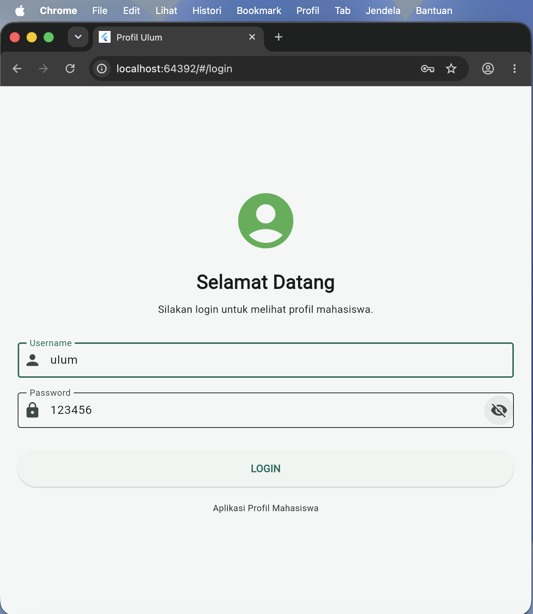
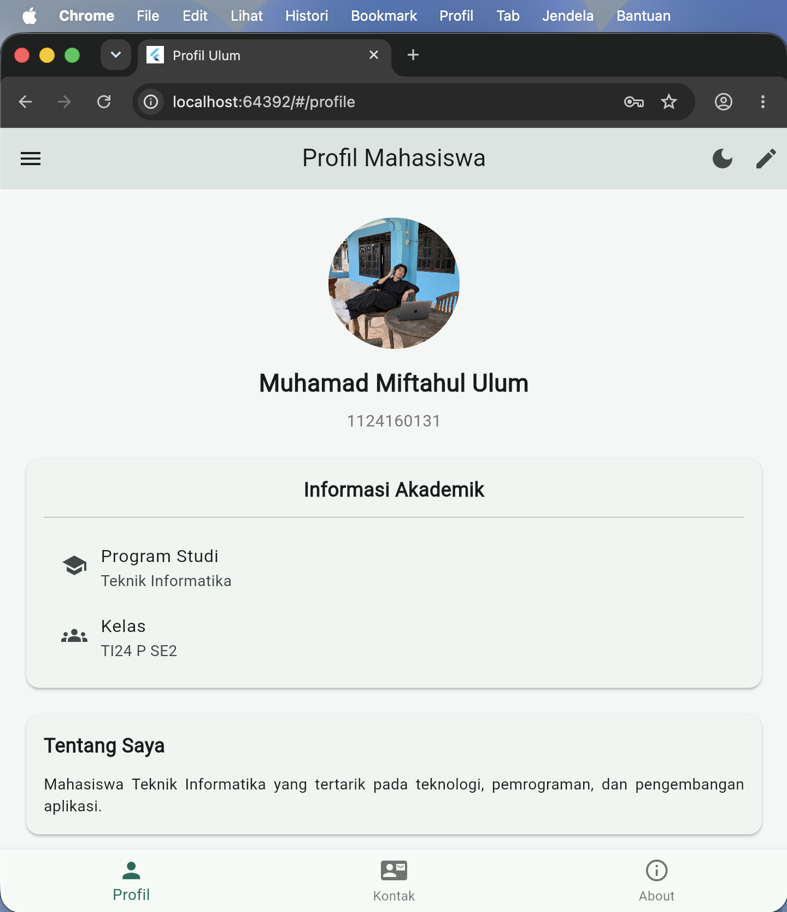
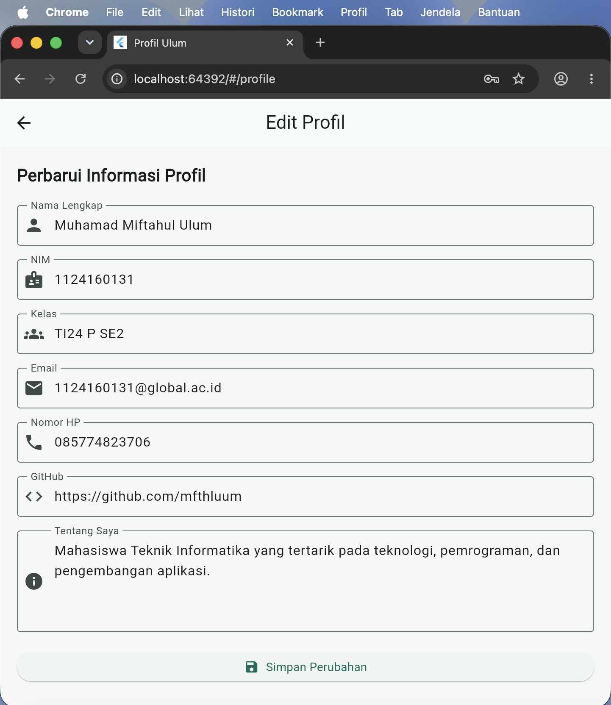

# UTS PML – Aplikasi Profil Mahasiswa

Aplikasi Profil Mahasiswa berbasis **Flutter** yang dikembangkan untuk memenuhi tugas Ujian Tengah Semester (UTS) mata kuliah Pemrograman Mobile.

Aplikasi ini menyediakan fitur login, menampilkan informasi profil mahasiswa, mengedit profil, halaman About Me, serta pengaturan tema gelap dan terang.

## Identitas Mahasiswa

| Informasi | Keterangan |
|---|---|
| Nama | Muhamad Miftahul Ulum |
| NIM | 1124160131 |
| Program Studi | Teknik Informatika |
| Konsentrasi | Software Engineering |
| Mata Kuliah | Pemrograman Mobile |

## Dokumentasi Video

Video demonstrasi dan penjelasan kode aplikasi dapat dilihat melalui YouTube:

[**Tonton Video Dokumentasi UTS PML**](https://youtu.be/PkUZ2nmimq0)

## Fitur Aplikasi

1. **Login** – Halaman autentikasi dengan validasi input.
2. **Profil Mahasiswa** – Menampilkan foto, identitas, dan informasi akademik.
3. **Edit Profil** – Memungkinkan pengguna memperbarui informasi profil.
4. **Informasi Kontak** – Menampilkan email, nomor HP, dan GitHub.
5. **About Me** – Menampilkan informasi tentang pembuat aplikasi.
6. **Dark Mode** – Mendukung tampilan tema terang dan gelap.
7. **Navigasi** – Menggunakan Drawer dan Bottom Navigation untuk berpindah halaman.

## Dokumentasi Screenshot

### 1. Halaman Login



### 2. Halaman Profil Mahasiswa



### 3. Halaman Edit Profil



## Download Aplikasi

Aplikasi Android versi Release dapat diunduh melalui GitHub Releases:

[**Download Aplikasi Profil Mahasiswa – APK v1.0.0**](https://github.com/mfthluum/uts-pml-1124160131/releases/download/v1.0.0/app-release.apk)

**Informasi versi:**
- Versi: 1.0.0
- Platform: Android
- Format: APK
- Build: Release

## Teknologi yang Digunakan

- Flutter
- Dart
- Visual Studio Code
- Android SDK

## Konsep Pemrograman Flutter

Beberapa konsep yang diterapkan dalam aplikasi:

- **MaterialApp:** Mengatur konfigurasi utama aplikasi, tema, dan navigasi.
- **Scaffold:** Membentuk struktur dasar halaman aplikasi.
- **Form dan Validator:** Mengelola serta memvalidasi input pengguna.
- **setState():** Memperbarui tampilan ketika terjadi perubahan state.
- **Navigator:** Mengatur perpindahan halaman dan pengiriman data antarhalaman.

## Cara Menjalankan Aplikasi

Pastikan Flutter SDK sudah terpasang pada perangkat.

1. Clone repository:

   ```bash
   git clone https://github.com/mfthluum/uts-pml-1124160131.git
   ```

2. Masuk ke direktori proyek aplikasi:

   ```bash
   cd uts-pml-1124160131/soal_2_profil_app
   ```

3. Install dependencies:

   ```bash
   flutter pub get
   ```

4. Jalankan aplikasi:

   ```bash
   flutter run
   ```

## Repository

Source code proyek dapat diakses melalui:

[https://github.com/mfthluum/uts-pml-1124160131](https://github.com/mfthluum/uts-pml-1124160131)

---

**Dibuat oleh Muhamad Miftahul Ulum**  
UTS Pemrograman Mobile – 2026